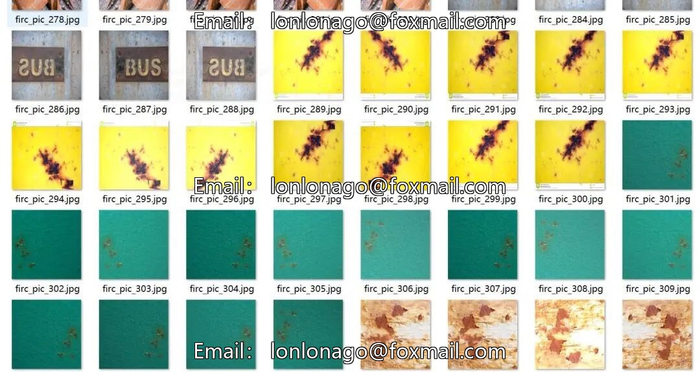
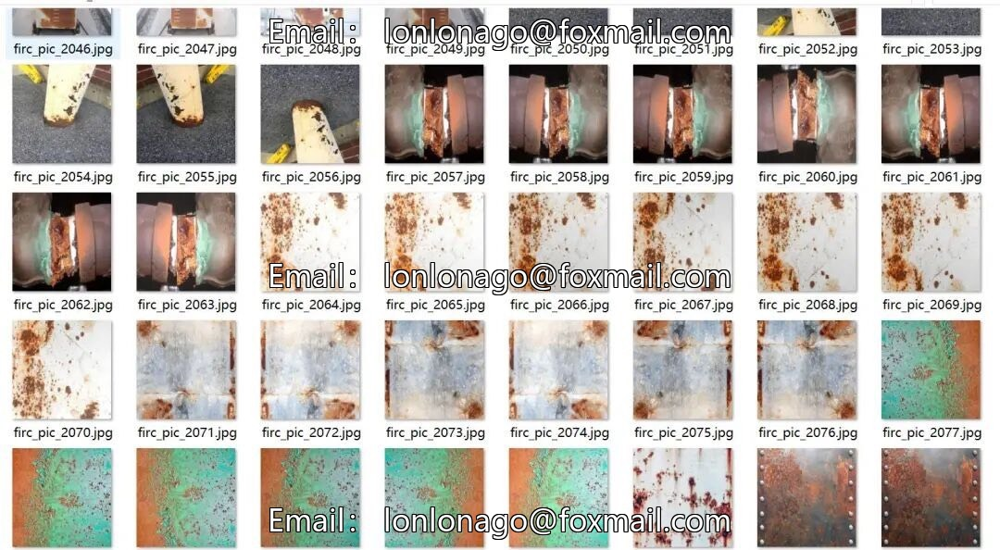
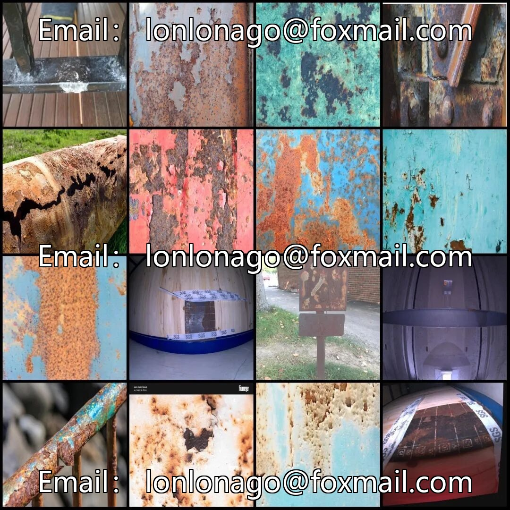
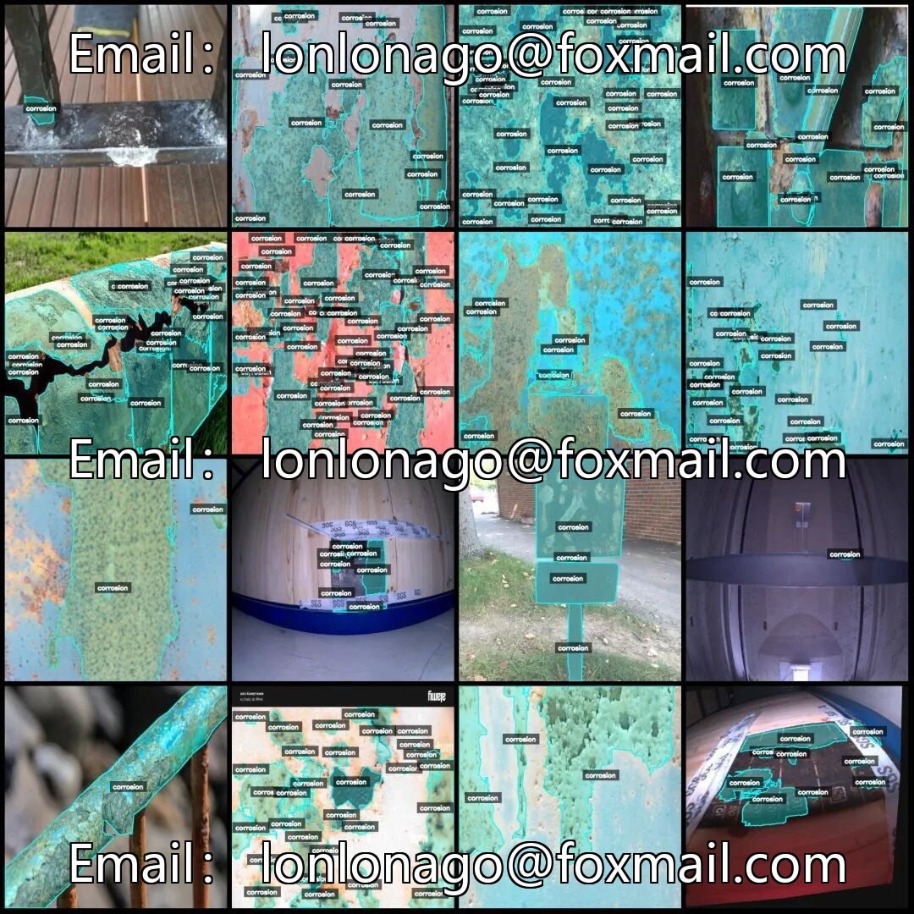

# Intelligent Industrial Metal Rust Identification and Segmentation Dataset, LabelMe format, total 263

## Body

Intelligent Industrial Metal Corrosion Identification and Segmentation Dataset, in labelme format, consisting of 2635 images, with one labeled category (corrosion), total number of labeled bounding boxes 31064. The dataset includes a large number of image enhancements, approximately 300 original images, with the remaining being enhanced images. The format is jpg and corresponding json, without mask files. The dataset is labeled using labelme 5.5.0 with an image resolution of 640x640, and the labeling rules are to draw polygons around the category.

The dataset can be directly used for tasks such as metal rust detection and segmentation, suitable for AI model training and research. Supports custom conversion to Yolo or Coco formats, facilitating semantic segmentation or instance segmentation.

Virtual materials, once sold, are non-refundable.
Interested friends, click "I want" to proceed.

## Images

## Payment

Here is a pay link on Stripe ( https://buy.stripe.com/3cs8yP7sY87d0vu9AB ). Please contact me lonlonago@foxmail.com after funding $89, and I will send you a complete data files , thank you!

